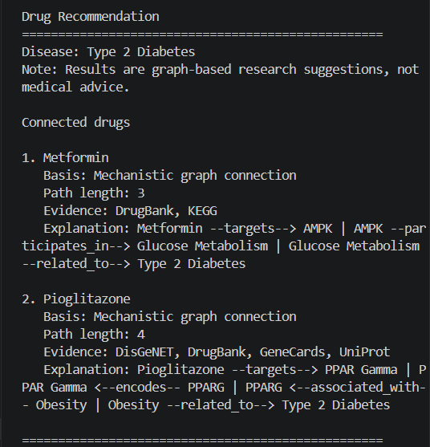
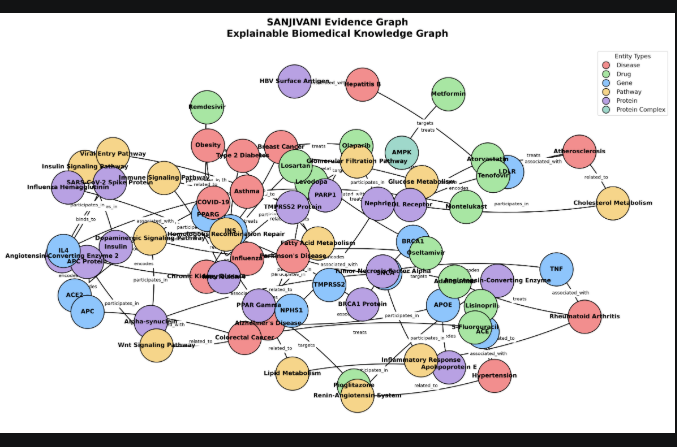

<h1 align="center">SANJIVANI Evidence Graph</h1>
<p align="center"><b>An explainable, evidence-aware biomedical knowledge graph for exploring drug-repurposing hypotheses</b></p>

<p align="center">
  <a href="https://sanjivani-evidence-graph.streamlit.app/"></a>
  <a href="https://github.com/Ishitta-Sarkar/sanjivani-evidence-graph/actions/workflows/ci.yml"></a>
  <a href="LICENSE"></a>
</p>

> **Try it:** https://sanjivani-evidence-graph.streamlit.app/ (if the app has been idle, click *"Yes, get this app back up"* and wait about 30 seconds).

## Overview

Biomedical knowledge about diseases, genes, proteins, pathways and drugs is spread across many databases. SANJIVANI puts a curated set of these relationships into one graph where **every edge carries its evidence source**. In a Streamlit interface you can:

- search entities and see quick facts
- find **multi-hop paths** between any two entities (for example drug → target → pathway → disease), each explained step by step
- explore **drug-repurposing candidates** for a disease, with the supporting path and its confidence score shown
- give each path a **transparent confidence score** based on its evidence sources (see below)
- filter by evidence source, view the interactive graph (PyVis), and see counts of entity types, relationship labels and evidence sources
- export TXT reports and CSV evidence tables

`python main.py` searches the same graph, prints the same confidence score, and reports average degree, density and the highest-degree entities.

It's a **research and teaching prototype**. It generates hypotheses for exploration, not clinical recommendations.

## Demo

| Drug-repurposing exploration | Graph analytics | Interactive graph |
|---|---|---|
|  |  |  |

## Knowledge base (v1.0.1)

Counted by reading `data/entities.csv` and `data/relationships.csv` with pandas (71 entity rows, 74 relationship rows). Every relationship endpoint is one of those entities, and every edge has an evidence label.

| | |
|---|---|
| Entities | 71 (Protein 17 · Disease 14 · Gene 13 · Pathway 13 · Drug 13 · Protein complex 1) |
| Relationships | 74 (`participates_in` 16, `associated_with` 14, `encodes` 13, `related_to` 13, `treats` 11, `targets` 6, `binds_to` 1) |
| Diseases | type 2 diabetes, obesity, Alzheimer's disease, Parkinson's disease, breast cancer, COVID-19, influenza, hypertension, atherosclerosis, colorectal cancer, chronic kidney disease, rheumatoid arthritis, asthma, hepatitis B |
| Evidence sources | DrugBank 17 · UniProt 16 · Reactome 15 · GeneCards 12 · KEGG 12 · DisGeNET 2 |

Files: [`data/entities.csv`](data/entities.csv) (`Entity, Type`) and [`data/relationships.csv`](data/relationships.csv) (`Source, Relationship, Target, Evidence`). The edges were curated by hand from the listed resources. They do not yet carry stable identifiers (UniProt accessions, DrugBank IDs, Reactome stable IDs) or an access date.

`src/graph_analytics.py` treats each relationship row as one undirected edge. Average degree is the mean node degree, rounded to two decimal places. Density is `relationships / (entities × (entities − 1) / 2)`, rounded to four decimal places. On this graph that function returns:

| | |
|---|---|
| Average degree | 2.08 |
| Density | 0.0298 |
| Highest degree | Parkinson's Disease, 4 connections |
| Next (degree 3, alphabetical) | Alzheimer's Disease; Angiotensin-Converting Enzyme; Angiotensin-Converting Enzyme 2; Asthma |

## How the path confidence score works

Each edge in a path scores points from its evidence source. The weights record how that source is curated. They were set by hand for this release. They are not fitted to an experimental or clinical outcome.

| Evidence source | Points | Why |
|---|---|---|
| DrugBank | 5 | Expert-curated drug, target and indication records |
| Reactome | 5 | Peer-reviewed pathway reactions. Raised from 3, where it shared a bucket with any source the table did not name |
| KEGG | 5 | Manually curated pathway maps |
| UniProt | 4 | Expert-reviewed protein records |
| DisGeNET | 3 | Gene–disease resource that mixes expert curation and text mining. Named explicitly; it previously fell in the unnamed bucket, which was also 3 |
| GeneCards | 3 | Gene-centric aggregator. Lowered from 4, so an aggregated association does not outrank Reactome or match UniProt |
| Any other label, or an empty value | 0 | No recognised provenance. Previously these received 3 |

`score = Σ points`, `maximum = 5 × number of edges`. The path is **High** if `score ≥ 0.8 × maximum`, **Moderate** if `score ≥ 0.5 × maximum`, and **Low** otherwise. A path with no edges is Low. Labels must match the table exactly after stripping whitespace (`DrugBank` scores 5; `drugbank` scores 0).

Worked example, the shortest undirected path from Metformin to type 2 diabetes (`BiomedicalGraph.find_path`):

1. Metformin —targets→ AMPK (DrugBank, 5)
2. AMPK —participates_in→ Glucose Metabolism (KEGG, 5)
3. Glucose Metabolism —related_to→ Type 2 Diabetes (KEGG, 5)

`score = 15/15`, **High**.

A one-edge GeneCards statement, Type 2 Diabetes —associated_with→ INS, scores `3/5`, **Moderate**.

The same function, `src/scoring.py`, is used by the Path Explorer, the drug-candidate cards, the downloaded path report, and the command-line explorer.

## Quick start

Tested on Python 3.12. The pinned Streamlit and NetworkX releases require Python 3.12 or newer.

```bash
git clone https://github.com/Ishitta-Sarkar/sanjivani-evidence-graph.git
cd sanjivani-evidence-graph
python -m venv .venv && source .venv/bin/activate   # Windows: .venv\Scripts\activate
pip install -r requirements.txt
streamlit run app.py          # web app
python main.py                # command-line explorer
```

Tests and the linter:

```bash
pip install -r requirements-dev.txt
pytest
ruff check .
```

On Streamlit Community Cloud, set the app's Python version to **3.12** in Advanced settings. `runtime.txt` records that version; the cloud app uses the version selected in its settings.

## Repository layout

```text
app.py                 Streamlit entry point (sidebar and page dispatch)
main.py                command-line explorer
src/
  graph_builder.py     BiomedicalGraph used by the command line
  entity_loader.py     entity-type lookup for the command line
  data_validator.py    schema checks on the relationship CSV
  graph_analytics.py   degree, density and hub ranking
  graph_visualizer.py  static figure
  drug_recommender.py  path-based repurposing for the command line
  scoring.py           path confidence weights
  loaders.py           CSV loading for the web app
  explore.py           path search and drug candidates for the web app
  entities.py          type, colour and icon lookup
  interactive.py       PyVis figures
  ui/                  one module per Streamlit page
  version.py
data/                  entities.csv, relationships.csv
docs/architecture.md   design notes
screenshots/           interface captures
visualizations/        static figure
tests/                 pytest
```

## Limitations

- Demonstration-scale, manually curated knowledge base (74 edges)
- Evidence is recorded at the level of the source database, not as an individual record or a publication
- No stable identifiers or access dates on the edges
- Heuristic confidence scoring; no learned model
- Not validated experimentally or clinically

## Roadmap

- [x] Unit tests and CI for graph building, path finding and scoring
- [x] Split the Streamlit interface into page modules
- [ ] Stable identifiers and access dates for every edge, and a reproducible build from public sources (for example Reactome, UniProt, Open Targets, or a PrimeKG subset)
- [ ] A larger graph and a graph-ML link-prediction benchmark against held-out edges
- [ ] Literature evidence (PubMed IDs) on each edge

## Citation

Please cite via [`CITATION.cff`](CITATION.cff) (GitHub's **"Cite this repository"** button):

> Sarkar, I. (2026). *SANJIVANI Evidence Graph: an explainable biomedical knowledge-graph platform* (v1.0.0) [Software]. https://github.com/Ishitta-Sarkar/sanjivani-evidence-graph

## License

[MIT](LICENSE) © 2026 Ishitta Sarkar. The data files summarise facts from public resources; check each source's terms before you reuse it (DrugBank in particular has its own licence).

## Author

**Ishitta Sarkar**

- M.Tech in Bioinformatics (in progress, expected 2028)
- B.Tech Biotechnology (Honours), Dr. A.P.J. Abdul Kalam Technical University, 2022-2026
- [ORCID 0009-0008-1028-6010](https://orcid.org/0009-0008-1028-6010)
- [GitHub](https://github.com/Ishitta-Sarkar)
